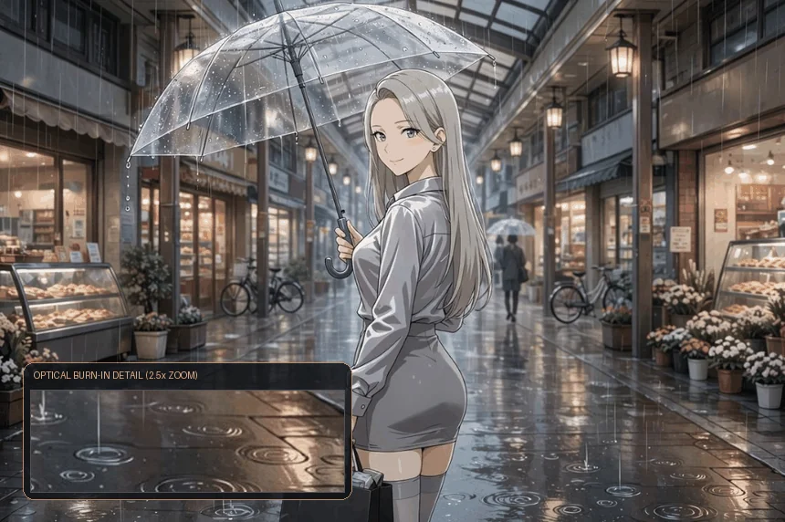
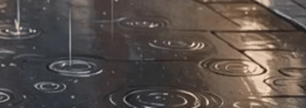
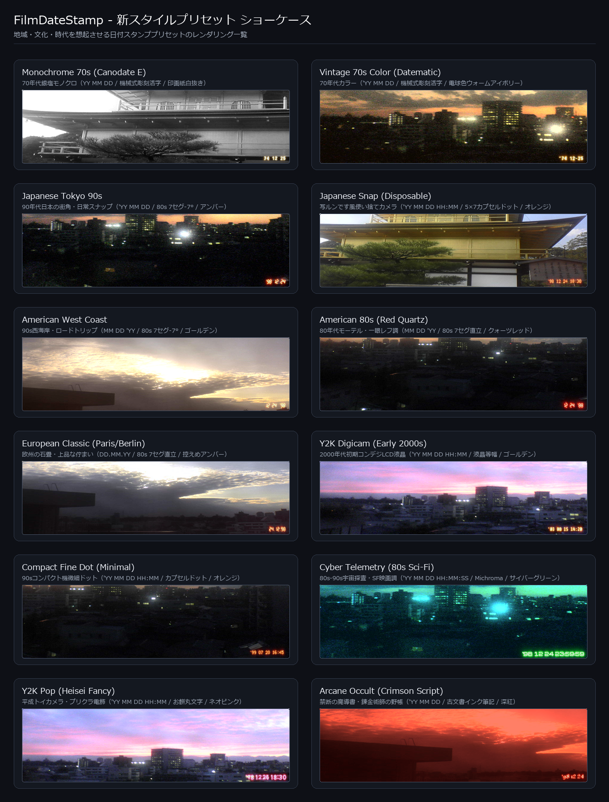

<div align="center">

# 🎞️ film-date-agent

### Authentic Film Quartz Date Stamp Optical Exposure Engine for AI Agents & CLI

[](pyproject.toml)
[](pyproject.toml)
[-success.svg?style=flat-square)](src/film_date_agent/engine/)
[-brightgreen.svg?style=flat-square)](tests/)
[](LICENSE)
[](src/film_date_agent/engine/fonts/LICENSE-OFL.txt)

<br />

**[🇺🇸 English](README.md)** | **[🇯🇵 日本語 (Japanese)](README_JA.md)**

<br />

[Why film-date-agent?](#why-film-date-agent) • [Key Features](#key-features) • [Presets Gallery](#presets-gallery) • [Optical Burn-in Physics](#optical-burn-in-physics--architecture) • [AI Agent Guide](#ai-agent-guide) • [CLI Reference](#cli-reference) • [Best Practices & Rules](#best-practices--pipeline-rules) • [FAQ](#faq)

<br />



<br />

*“Not a flat transparent overlay. A true optical simulation of LED filament exposure, emulsion saturation, and halation bleeding onto chemical film.”*

</div>

---

## 💡 Why film-date-agent?

When adding retro date stamps to photographs, most tools merely **draw text and alpha-blend it over the image** or, at best, **apply a simple Gaussian blur with Screen/Add blending**.

In reality, vintage 35mm film cameras equipped with quartz databanks (data backs) functioned by firing micro-LED emitters from behind the film pressure plate, **physically exposing and burning light directly into the undeveloped silver halide emulsion**.

This real-world chemical and optical phenomenon introduces intricate behaviors:
- **Core Filament Bleach**: The center of the LED emitter saturates the emulsion, bleaching into pure white.
- **Spectral Wavelength Scattering**: Long-wavelength orange and red photons scatter deep inside the emulsion and the film base layer, creating characteristic blooming and red halation halos.
- **Emulsion Headroom Saturation**: In bright highlights or white backgrounds where silver halide grains are already fully saturated, no additional exposure capacity remains. The stamp naturally melts and fades into the white highlights instead of floating artificially on top.
- **Organic Mechanical Imperfections**: Subtle variations in camera pressure plate flatness, LED element tolerances, and micro-lens distortions create organic per-character variations, subtle tilts, and intensity shifts.

The table below contrasts naive implementations with the design philosophy of `film-date-agent`.

### 📊 Comparative Architecture

| Dimension / Philosophy | Naive Implementations (Alpha Overlay) | Standard Tools & Nodes | This Project (`film-date-agent`) |
|---|---|---|---|
| **Optical Model** | Alpha blend (flat semi-transparent pixels) | Screen / Add additive blend | **Non-linear spectral exposure based on H&D characteristic curves** |
| **Emitter Core** | Single flat RGB fill color | Uniform gaussian blur | **Inner distance transform for high-intensity filament core bleach** |
| **Halation & Scatter** | None (or simple circular blur) | Single-scale gaussian blur | **FFT multi-scale PSF scattering (Direct, Emulsion, and Veiling Glare)** |
| **Background Interaction** | Floats uniformly regardless of scene luminance | Blows out or becomes illegible over white | **Luminance-aware Emulsion Headroom & shoulder compression** |
| **Organic Imperfection** | Rigid digital vector rendering | Uniform synthetic noise | **3-tier organic fluctuations: Macro (Lens/Char), Meso (Warp), Micro (Grain)** |
| **Footprint & Speed** | Pillow only | Requires PyTorch, CUDA GPU, ComfyUI | **100% Pure NumPy + Pillow (~50ms CPU execution, zero heavy deps)** |
| **AI Agent Interface** | None (Manual GUI only) | Visual node wiring only | **CLI with `--json`, capability discovery, and built-in `doctor` self-test** |

---

## 🌟 Key Features

- 🎞️ **True Optical Burn-in Simulation**  
  Complete reproduction of filament core bleaching, wavelength-dependent spectral sensitivity, multi-scale PSF halation, and mechanical fluctuations from camera pressure plates.

  <div align="center">
    
  </div>

- 📷 **Automatic EXIF Capture Date Extraction (`DateTimeOriginal`)**  
  Extracts the original capture timestamp directly from image EXIF metadata. Automatically falls back to filesystem timestamps or the current time when EXIF is absent (e.g. for AI-generated images).
- 🎨 **12 Authentic Style Presets Spanning Eras & Cultures**  
  Instantly recreate iconic vibes including `Japanese Tokyo 90s` (Amber 80s 7-segment), `Japanese Snap (Disposable)` (Utsurundesu orange capsule dots), `American West Coast` (Golden yellow roadtrip), `American 80s (Red Quartz)` (Motel red LED), and `Cyber Telemetry` (Sci-Fi HUD green).
- 🔤 **8 Bundled TrueType Fonts Engineered for Historical Accuracy**  
  Custom-engineered Suwa Seikosha 1980s 7-segment (-7° italic and upright), disposable camera 5×7 capsule dots, 1970s mechanical engraved dies (Canodate/Datematic), LCD monospace, Sci-Fi telemetry, and vintage Heisei pop round gothic.
- 🎭 **Simultaneous Alpha Mask Export**  
  Export the exact optical emission alpha mask with `--save-mask mask.png`. Ideal for secondary compositing pipelines, grain grading, or non-destructive inpainting.
- ⚡ **Ultra-Lightweight & Fast (Zero GPU / PyTorch Needed)**  
  Built entirely upon NumPy and Pillow. Operates seamlessly on standard CPUs in 50ms to a fraction of a second with zero CUDA or ComfyUI dependencies.

### 🗣️ Natural Language Control for AI Agents

No need to memorize CLI flags or parameters. When interacting with an AI agent (Muse, Claude, Gemini, Antigravity, etc.), users can simply express their intent in everyday language:

| What the User Says | What the Agent Executes |
|---|---|
| “Add a date stamp to this photo” | Burns the default favorite preset (`Japanese Snap (Disposable)`) using EXIF capture date |
| “Make it look like a 90s disposable camera” | Automatically selects the appropriate vintage preset (`--preset japanese-snap-disposable`) |
| “Use the photo's original EXIF date” | Auto-extracts EXIF capture timestamp (`--date photo`) |
| “Include the time as well” / “Just the date” | Toggles hours and minutes display (`--show-time` / `--no-time`) |
| “Set the date to December 24, 1998” | Burns specific target timestamp (`-d "'98 12 24"`) |
| “Make this my default setting” | Saves current configuration as the persistent favorite |

---

## 🎨 Presets Gallery

Instantly accessible presets crafted to capture iconic eras, regions, and photographic cultures. Colors, optical bloom halation, emitter geometry, and typography are meticulously tuned.

<div align="center">
  
</div>

| Preset Name | Era & Aesthetic | Date Format | Font Family | Glow & Halation Color |
|---|---|---|---|---|
| `Japanese Tokyo 90s` | 1990s Japanese street & snapshot | `'YY MM DD` | 80s 7-Segment (-7° shear) | Amber Classic |
| `Japanese Snap (Disposable)` *(Default)* | Disposable camera with timestamp | `'YY MM DD HH:MM` | 5×7 Capsule Dot | Fuji Orange |
| `American West Coast` | 1990s West Coast roadtrip | `MM DD 'YY` | 80s 7-Segment (-7° shear) | Golden Yellow |
| `American 80s (Red Quartz)` | 1980s motel & SLR red LED quartz | `MM DD 'YY` | 80s 7-Segment (Upright) | Quartz Red |
| `European Classic (Paris/Berlin)` | European cobblestones & subtle burn | `DD.MM.YY` | 80s 7-Segment (Upright) | Amber Classic (Subtle) |
| `Y2K Digicam (Early 2000s)` | Early 2000s consumer digicam LCD | `'YY MM DD HH:MM` | Monospace LCD Dot | Golden Yellow |
| `Compact Fine Dot (Minimal)` | 1990s compact camera micro-dot | `'YY MM DD HH:MM` | Fine Capsule Dot | Fuji Orange |
| `Monochrome 70s (Canodate E)` | 1970s silver halide black & white | `YY MM DD` | 70s Mechanical Stamp | Paper White |
| `Vintage 70s Color (Datematic)` | 1970s vintage warm color stamp | `'YY MM DD` | 70s Mechanical Stamp | Bulb Warm Ivory |
| `Cyber Telemetry (Sci-Fi)` | Sci-Fi cinema HUD & surveillance | `YYYY-MM-DD HH:MM:SS` | Telemetry Monospace | Cyber Green |
| `Heisei Retro Maru (Pop)` | Japanese Heisei retro pop sticker | `'YY MM DD` | Heisei Maru Gothic | Neo Pink |
| `Manuscript Archival (Doc)` | Archival document stamp | `YYYY/MM/DD` | Classic Serif | Paper White (Intaglio) |

---

## 🔬 Optical Burn-in Physics & Architecture

`film-date-agent` embeds the standalone mathematical core of the acclaimed ComfyUI node `FilmDateStamp`.

<details>
<summary><b>View Internal Pipeline ASCII Architecture</b></summary>

```
[ Input Image ] (sRGB Color Space)
     │
     ▼
[ sRGB → Linear RGB Physical Luminance Conversion ]
     │
     ├─────────────────────────────────────────┐
     │                                         ▼
     │                             [ Extract Background Luminance Y ]
     │                             Y = 0.2126R + 0.7152G + 0.0722B
     │                                         │
     │                                         ▼
     │                             [ Compute Emulsion Headroom ]
     │                             Headroom = clip(1.0 - Y^1.35 * 0.72)
     ▼                                         │
[ Text Rendering (Octagonal Metric) ]           │
     │                                         │
     ├─► [ Iterative Morphological Erosion ]    │
     │        └─► [ LED Emitter Core Ridge ]    │
     │                                         │
     ├─► [ ① Macro Fluctuation (Lens/Chars) ]   │
     │                                         │
     ├─► [ Single-Pass FFT Multi-Scale OTF ]   │
     │        ├─► mid (Direct Scatter)         │
     │        ├─► wide (Emulsion Halation)     │
     │        └─► veil (Rear Film Base Glare)  │
     │                                         │
     ├─► [ ② Meso Fluctuation (Plate Warp) ]   │
     │                                         │
     ├─► [ ③ Micro Fluctuation (Grain/Dye) ]   │
     │                                         │
     ├─► [ H&D Non-Linear Spectral Curves ]    │
     │                                         │
     └─► [ Optical Emission Map Light_lin ]    │
                     │                         │
                     ▼                         ▼
        [ Effective Exposure Eff_Light = Light_lin * Headroom ]
                     │
                     ▼
        [ Film Shoulder Compression (Characteristic Curve) ]
                     │
                     ▼
        [ Linear RGB → sRGB Conversion & Gamma Restoration ]
                     │
                     ▼
             [ Final Composite Image ] + [ Alpha Mask PNG ]
```

</details>

### Mathematical & Physical Highlights

1. **Octagonal Metric Inner Distance Transform**:  
   Extracts high-intensity filament hotspots along the text spine in milliseconds via pure NumPy bitwise morphology without requiring heavy scientific toolkits like `scipy.ndimage`.
2. **Frequency-Domain (FFT) Composite OTF Halation**:  
   Combines `mid` (direct scatter), `wide` (emulsion bleeding), and `veil` (rear film base reflection) halation kernels into a single Optical Transfer Function in frequency space, executing multi-scale bloom across large images in a single inverse FFT pass.
3. **Three-Tier Organic Fluctuations**:  
   - **Macro**: Linear intensity gradients across the optical module, character-to-character and segment-to-segment LED electrical resistance tolerances.
   - **Meso**: Anisotropic elliptical scattering caused by pressure plate bowing and micro-deflection, warped via multi-octave Fractal Brownian Motion (FBM) displacement fields.
   - **Micro**: Stochastic silver halide grain modulation (Grain Field) and chemical dye cloud clusters.
4. **H&D Characteristic Curve & Filament Core Bleach**:  
   Simulates classic Hurter & Driffield sensitometric response across individual spectral channels ($\text{sens}_{R,G,B}$, $\text{scatter}_{R,G,B}$). Core filament zones saturate exponentially to produce authentic optical burnout into pure white.
5. **Luminance-Aware Emulsion Headroom Synthesis**:  
   $$Y = 0.2126R_{\text{lin}} + 0.7152G_{\text{lin}} + 0.0722B_{\text{lin}}$$
   $$\text{Headroom} = \text{clip}\left(1.0 - Y^{1.35} \times 0.72, 0.12, 1.0\right)$$
   Where background pixels are already high in luminance, the photographic emulsion lacks the chemical headroom to register additional photons. The stamp organically fades into bright highlights without unsightly dark borders or artificial clipping.

---

## 🤖 AI Agent Guide

Autonomous agents (Muse, Claude, Gemini, Antigravity, etc.) should follow these instructions to install, diagnose, and run the tool.

### 1. Installation

Recommended one-line automated installation (creates dedicated virtualenv, installs package, links binary to `~/.local/bin`, and runs diagnostic verification):

```bash
git clone https://github.com/treeturtlefall-arch/FilmDateStamp-agent.git
cd FilmDateStamp-agent
bash scripts/install_agent.sh
```

For manual setup:

```bash
python3 -m venv .venv
.venv/bin/pip install .
ln -sf "$PWD/.venv/bin/film-date-agent" ~/.local/bin/film-date-agent
```

### 2. Deploy Agent Skill Definition

```bash
# Linux / macOS
bash scripts/install_skill.sh

# Windows PowerShell
powershell -ExecutionPolicy Bypass -File scripts\install_skill.ps1
```

The target can be changed by keyword: `install_skill.sh gemini` deploys to `~/.gemini/config/skills/film-date-agent` (Gemini CLI / Antigravity); an explicit path works too, as does `$FILM_DATE_SKILL_DEST`. With no argument it deploys to Muse (`~/workspace/custom-skills/film-date-agent`).

### 3. Verification (`doctor` Check)

```bash
film-date-agent doctor --json
```

Verify that `"ok": true`. The doctor command verifies Python dependencies, system paths, bundled fonts, and cryptographic SHA-256 hashes of core engine assets.

### Agent Execution Rules

- **Standard Execution**:
  ```bash
  film-date-agent apply <target_image_path> --json
  ```
- **Use EXIF Capture Timestamp**:
  ```bash
  film-date-agent apply <target_image_path> --date photo --json
  ```
- **Disposable Camera Style with Time**:
  ```bash
  film-date-agent apply <target_image_path> --preset japanese-snap-disposable --json
  ```
- **Reporting Results**: Parse the `--json` output. If `"ok": true`, return the generated image path from `"output"` and report the stamped date text (`"date_text"`) to the user.
- **Detailed Skill Definition**: Refer to [`skill/SKILL.md`](skill/SKILL.md).

---

## 💻 CLI Reference

### Basic Commands

```bash
# 1. Apply default favorite preset (Japanese Snap Disposable)
film-date-agent apply photo.jpg

# 2. Extract and burn original EXIF capture timestamp
film-date-agent apply photo.jpg --date photo

# 3. Burn disposable camera style with time (HH:MM)
film-date-agent apply photo.jpg --preset japanese-snap-disposable --show-time

# 4. Burn explicit custom timestamp
film-date-agent apply photo.jpg -d "'98 12 24"
film-date-agent apply photo.jpg --at 1998-12-24T18:30 --show-time

# 5. Export optical emission alpha mask alongside image
film-date-agent apply photo.jpg --save-mask mask.png

# 6. Batch process an entire directory (auto-resolving each image's EXIF)
film-date-agent batch input_dir output_dir --date photo --json
```

### Managing Presets & Favorites

```bash
# List all available presets
film-date-agent presets list

# Inspect preset configuration
film-date-agent presets show japanese-tokyo-90s

# Set persistent favorite (applied by default when no preset is specified)
film-date-agent presets set-favorite japanese-snap-disposable

# Create and persist a custom user preset
film-date-agent presets create my-vintage --base japanese-tokyo-90s --color "Cyber Green" --show-time
```

### Diagnostics & Capability Catalog

```bash
# Diagnose environment, bundled assets, and engine integrity
film-date-agent doctor

# Output full JSON catalog of fonts, colors, and presets
film-date-agent capabilities --json
```

---

## 🛡️ Best Practices & Pipeline Rules

> [!IMPORTANT]
> **Overlay Belongs Last**  
> In image generation and enhancement pipelines, always place the date stamp burn-in **after AI upscalers, super-resolution models, and aggressive denoisers**. If applied before upscaling, diffusion models and denoisers misinterpret delicate LED filament bloom and halation fringes as unwanted sensor noise, artificially warping the stamp.

> [!TIP]
> **Professional Compositing with Alpha Masks**  
> Leverage `--save-mask mask.png` to integrate date stamps into advanced non-destructive workflows. Use the mask to inject customized film grain strictly over the emitted light rays, or to effortlessly remove and re-stamp dates using generative inpainting.

---

## ❓ FAQ

**Q: Why does the stamp look faint or washed out when applied over a white beach or bright sky?**  
A: This is intentional behavior: **it precisely mirrors real physical film chemistry**. In a silver halide emulsion, high-intensity sunlight already consumes all available light-sensitive halide crystals (highlight saturation). Firing an LED emitter into an already fully-exposed region produces little to no additional chemical density. If you require high contrast against bright scenes, adjust the position (`--position`) to a darker corner or increase exposure intensity via custom presets.

**Q: What happens if an image does not have EXIF metadata (e.g. AI-generated art)?**  
A: When `--date photo` is requested on an image lacking EXIF data, the engine automatically falls back to the file modification timestamp, and subsequently to the current system time. Processing will never abort or throw an error.

**Q: Do I need ComfyUI, PyTorch, or a GPU to run this?**  
A: **No.** `film-date-agent` is implemented entirely in NumPy and Pillow. It runs standalone on standard CPU hardware with execution times typically under 50 milliseconds.

---

## 📄 License & Acknowledgements

This project is licensed under the [MIT License](LICENSE).

Bundled font licensing:
- `FDS7Strict-Compact.ttf` / `FDS7Strict-SLR.ttf` / `FDSDotStrict-Regular.ttf` / `FDSMechanical70s-Regular.ttf`: [SIL Open Font License 1.1](src/film_date_agent/engine/fonts/LICENSE-OFL.txt) (FilmDateStamp Project)
- `ShareTechMono-Regular.ttf` / `Michroma-Regular.ttf` / `MochiyPopOne-Regular.ttf` / `EagleLake-Regular.ttf`: [SIL Open Font License 1.1](src/film_date_agent/engine/fonts/LICENSE-OFL.txt)

### Upstream
The optical rendering engine is based on the snapshot of the acclaimed ComfyUI node [FilmDateStamp](https://github.com/treeturtlefall-arch/FilmDateStamp). See [UPSTREAM.md](UPSTREAM.md) for details.
