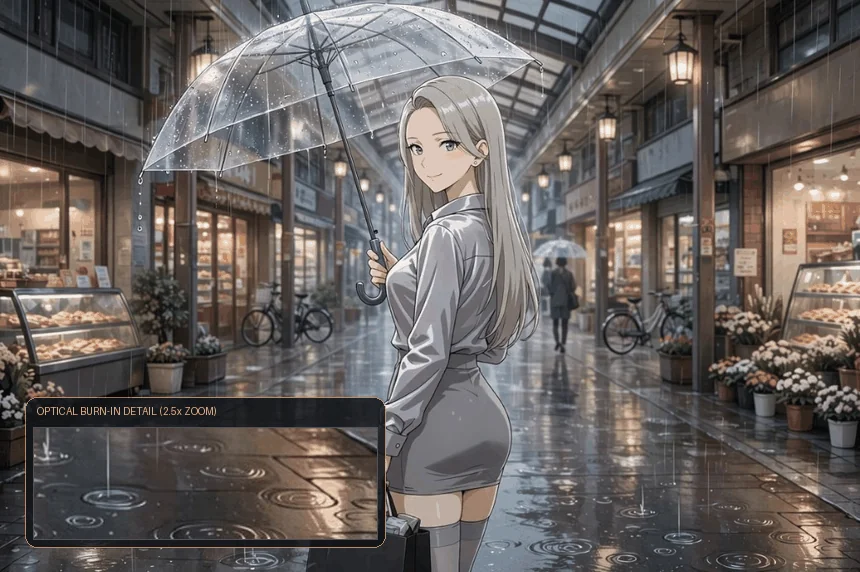
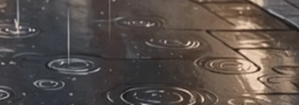
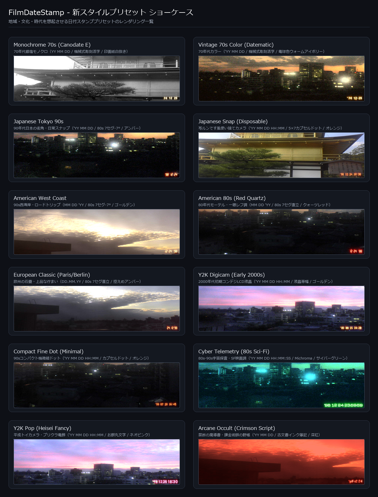

<div align="center">

# 🎞️ film-date-agent

### AIエージェント ＆ CLI のための本格フィルム日付スタンプ物理光学露光エンジン

[](pyproject.toml)
[](pyproject.toml)
[-success.svg?style=flat-square)](src/film_date_agent/engine/)
[-brightgreen.svg?style=flat-square)](tests/)
[](LICENSE)
[](src/film_date_agent/engine/fonts/LICENSE-OFL.txt)

<br />

**[🇺🇸 English](README.md)** | **[🇯🇵 日本語 (Japanese)](README_JA.md)**

<br />

[なぜこのツールなのか？](#なぜ-film-date-agent-なのか) • [主な特長](#主な特長) • [プリセットギャラリー](#プリセットギャラリー) • [物理光学シミュレーション仕様](#物理光学シミュレーションの構造) • [AIエージェント導入ガイド](#aiエージェント向け導入ガイド) • [CLI リファレンス](#cli-リファレンス) • [ベストプラクティス ＆ 鉄則](#ベストプラクティス--パイプラインの鉄則) • [FAQ](#faq)

<br />



<br />

*「単なる文字の貼り付け（透過オーバーレイ）ではない。フィルム乳剤へのLEDフィラメント露光、感光飽和、多重散乱ハレーションを物理シミュレートする。」*

</div>

---

## 💡 なぜ film-date-agent なのか？

写真にレトロな日付スタンプを入れる際、多くのツールは **「フォントを描画して半透明で重ねる（Alpha Overlay）」** か、せいぜい **「文字をガウスぼかしで広げて加算合成する」** だけにとどまっています。

しかし、実際のフィルムカメラ（クォーツデート / デートバック）は、フィルムの裏蓋側から微小なLED素子を発光させ、 **未現像のハロゲン化銀乳剤に光を直接焼き付ける（物理光学露光）** という仕組みで記録されていました。

その結果、現実の写真では以下のような極めて複雑な光学・化学現象が生じます：
- **発光芯の白飛び（Core Bleach）**: フィラメントの中心部は光量が飽和し、純白に焼き切れる。
- **波長別の分光散乱（Spectral Scattering）**: オレンジ・赤色の長波長光が乳剤層の深部やベースフィルム内で大きく散乱し、特有の赤いハレーションを形成する。
- **乳剤感光余力（Emulsion Headroom）**: 直射日光ハイライトや白い壁のような「すでに銀塩が飽和している領域」では、露光の余力が残されていないため文字が白の中に自然に埋もれて溶け込む。
- **有機的な機械ゆらぎ（Organic Imperfection）**: カメラの圧板の微小な浮きや湾曲、LED素子の個体差、レンズの歪みによって、文字ごとに微妙な滲みや傾き、光量差が生じる。

従来の素朴な実装と本プロジェクトの設計思想の違いは以下の通りです。

### 📊 従来手法との比較

| 項目・設計思想 | 従来の素朴な実装（Alpha Overlay） | 一般的なツール / ノード | 本プロジェクト (`film-date-agent`) |
|---|---|---|---|
| **露光モデル** | アルファブレンド（単なる半透明文字） | 加算合成（Screen / Add） | **H&D特性曲線に基づく非線形分光物理露光** |
| **発光芯の再現** | 単一のRGBベタ塗り | ぼかしのみ | **内部距離変換による高輝度芯の白飛び（Bleach）** |
| **ハレーション** | なし（または単純な円形ぼかし） | 単一ガウシアンブラー | **FFT多重PSF散乱（直接散乱・乳剤散乱・ベール光）** |
| **背景との相互作用** | 背景に関係なく均一に浮き上がる | 明るい背景で白飛びして読めない | **背景ルミナンス感光余力（Headroom）合成** |
| **有機的ゆらぎ** | 完全なデジタル直線・均一 | 一様なランダムノイズ | **Macro（レンズ/文字）/ Meso（圧板浮き）/ Micro（銀塩）3階層ゆらぎ** |
| **依存関係とフットプリント** | Pillow のみ | PyTorch / GPU / ComfyUI 必須 | **ピュア NumPy + Pillow（GPU不要・数十ミリ秒動作）** |
| **AIエージェント親和性** | なし（手動UI専用） | ノード接続UIのみ | **JSON入出力・能力カタログ・自己診断（`doctor`）完備** |

---

## 🌟 主な特長

- 🎞️ **物理光学露光（Optical Burn-in）シミュレーション**  
  中心フィラメント芯の白飛び（ブリーチ）、波長別の分光感光飽和、多重スケールPSFハレーション拡散、LED素子の個体差や圧板浮きの有機的ゆらぎを完全再現。

  <div align="center">
    
  </div>

- 📷 **写真のEXIF撮影日時（DateTimeOriginal）を自動反映**  
  写真ファイルのメタデータから当時の撮影日時を自動抽出し、正確な日付・時刻を焼き付けます。EXIF の無い画像（AI 生成画像など）ではファイルの生成時刻、それも無ければ現在時刻へと自動フォールバックします。
- 🎨 **時代・地域を象徴する12種類のスタイルプリセット**  
  `Japanese Tokyo 90s`（アンバー・80s 7セグ）、`Japanese Snap (Disposable)`（写ルンです風・時分併記オレンジドット）、`American West Coast`（西海岸ロードトリップ）、`American 80s (Red Quartz)`（モーテル赤色LED）、`Cyber Telemetry`（SF映画サイバーグリーン）などワンタッチで世界観を再現。
- 🔤 **自社製TrueTypeを含む実機準拠8フォント同梱**  
  1980年代諏訪精工舎モジュール実機準拠7セグ（-7°/0°）、写ルンです風カプセルドット、1970年代活字彫刻（Canodate/Datematic）、液晶等幅、SFテレメトリ、平成レトロ丸文字、古文書スクリプト。
- 🎭 **マスク画像（PNG）の同時出力対応**  
  `--save-mask mask.png` により、スタンプの発光領域アルファマスクを出力可能。後続の画像編集ツールで文字部分に粒子を乗せたり、除去・インペイントする用途にも活用できます。
- ⚡ **超軽量 ＆ 高速（PyTorch / GPU不要）**  
  純粋な NumPy + Pillow のみで実装されており、ComfyUI や PyTorch のインストールは一切不要。数十ミリ秒〜1秒程度で軽快に動作します。

### 🗣️ 設定変更は「普通の言葉」でエージェントに伝えるだけ

コマンドやオプションを覚える必要はありません。対応する AI エージェント（Muse / Claude / Gemini / Antigravity 等）に、普段の言葉で頼むだけで設定が伝わります。エージェント側のスキル定義が、言葉をプリセットとオプションに変換します。

| こう伝える | エージェントが実行する内容 |
|---|---|
| 「この写真に日付スタンプを入れて」 | 既定のお気に入り（`Japanese Snap (Disposable)`）で焼き付け。日付は撮影日時／生成時刻を自動反映 |
| 「写ルンですっぽくして」「90年代東京スナップ風で」 | 世界観に合うプリセットへ切り替え |
| 「撮影日時を焼き付けて」「EXIF の日付で」 | 写真の EXIF 撮影日時を自動反映（`--date photo`） |
| 「時間も入れて」「日付だけでいい」 | 時刻（HH:MM）の表示 ON / OFF |
| 「1998年12月24日にして」 | 指定した日付で焼き付け |
| 「この設定をいつものにして」 | 現在の設定をお気に入り（favorite）として保存 |

---

## 🎨 プリセットギャラリー

時代・地域・文化の象徴的な写真表現を再現したスタイルプリセットをワンタッチで呼び出せます。文字色、発光（Optical Burn-in）のハレーション強度、LED素子の形状やフォントがあらかじめ調律されています。

<div align="center">
  
</div>

| プリセット名 | 時代・世界観 | 日付フォーマット | フォント種別 | 発光カラー |
|---|---|---|---|---|
| `Japanese Tokyo 90s` | 90年代日本の街角・日常スナップ | `'YY MM DD` | 80s 7セグ -7° 傾斜 | Amber Classic |
| `Japanese Snap (Disposable)` *(既定)* | 写ルンです風・時分併記 | `'YY MM DD HH:MM` | 5×7 カプセルドット | Fuji Orange |
| `American West Coast` | 90年代西海岸・ロードトリップ | `MM DD 'YY` | 80s 7セグ -7° 傾斜 | Golden Yellow |
| `American 80s (Red Quartz)` | 80年代モーテル・一眼レフ赤色LED | `MM DD 'YY` | 80s 7セグ 直立 | Quartz Red |
| `European Classic (Paris/Berlin)` | 欧州の石畳・上品で控えめな露光 | `DD.MM.YY` | 80s 7セグ 直立 | Amber Classic (弱) |
| `Y2K Digicam (Early 2000s)` | 2000年代初頭の初期コンデジLCD | `'YY MM DD HH:MM` | 液晶等幅ドット | Golden Yellow |
| `Compact Fine Dot (Minimal)` | 90年代コンパクト機微細ドット | `'YY MM DD HH:MM` | 微細カプセルドット | Fuji Orange |
| `Monochrome 70s (Canodate E)` | 70年代銀塩モノクロ印画紙 | `YY MM DD` | 70年代機械式活字 | Paper White |
| `Vintage 70s Color (Datematic)` | 70年代ヴィンテージカラー | `'YY MM DD` | 70年代機械式活字 | Bulb Warm Ivory |
| `Cyber Telemetry (Sci-Fi)` | SF映画・HUD・監視カメラ | `YYYY-MM-DD HH:MM:SS` | SFテレメトリ | Cyber Green |
| `Heisei Retro Maru (Pop)` | 平成レトロ・丸文字プリクラ風 | `'YY MM DD` | 平成丸ゴシック | Neo Pink |
| `Manuscript Archival (Doc)` | 古文書・公文書アーカイブ | `YYYY/MM/DD` | クラシックセリフ | Paper White (陰刻) |

---

## 🔬 物理光学シミュレーションの構造

`film-date-agent` は、ComfyUI の本格露光ノード `FilmDateStamp` の計算コアをそのままスタンドアロン化したエンジンを内蔵しています。

<details>
<summary><b>内部パイプラインの ASCII アーキテクチャを表示</b></summary>

```
[ 入力画像 ] (sRGB 空間)
     │
     ▼
[ sRGB → Linear RGB 物理輝度変換 ]
     │
     ├─────────────────────────────────────────┐
     │                                         ▼
     │                             [ 背景ルミナンス Y 抽出 ]
     │                             Y = 0.2126R + 0.7152G + 0.0722B
     │                                         │
     │                                         ▼
     │                             [ 乳剤感光余力 Headroom 計算 ]
     │                             Headroom = clip(1.0 - Y^1.35 * 0.72)
     ▼                                         │
[ テキスト描画 (八角形メトリック) ]             │
     │                                         │
     ├─► [ 反復モルフォロジー収縮 ]            │
     │        └─► [ LED 発光尾根 Core 抽出 ]   │
     │                                         │
     ├─► [ ① Macro ゆらぎ (レンズ傾斜・文字間) ] │
     │                                         │
     ├─► [ FFT 3重多重散乱合成 ]               │
     │        ├─► mid (直接散乱)               │
     │        ├─► wide (乳剤ハレーション)      │
     │        └─► veil (裏面反射ベール光)      │
     │                                         │
     ├─► [ ② Meso ゆらぎ (圧板浮き・変位ワープ) ] │
     │                                         │
     ├─► [ ③ Micro ゆらぎ (銀塩粒子・色素群) ]  │
     │                                         │
     ├─► [ H&D 分光感光特性曲線 ＋ 芯白飛び ]    │
     │                                         │
     └─► [ 光学露光マップ Light_lin 取得 ]      │
                     │                         │
                     ▼                         ▼
        [ 実効露光量 Eff_Light = Light_lin * Headroom ]
                     │
                     ▼
        [ フィルム肩特性 (Shoulder Compression) 合成 ]
                     │
                     ▼
        [ Linear RGB → sRGB 変換 ＋ ガンマ復元 ]
                     │
                     ▼
             [ 最終出力画像 ] ＋ [ マスク PNG ]
```

</details>

### 数理モデルのポイント

1. **八角形メトリック内部距離変換（Inner Distance Transform）**:
   外部ライブラリ（`scipy.ndimage` 等）に一切依存せず、純粋な NumPy ビット演算による反復モルフォロジー収縮で文字ストロークの中心尾根（LEDホットスポット）をミリ秒単位で抽出します。
2. **周波数領域（FFT）単一パス多重PSF散乱合成**:
   `mid`（直接散乱）、`wide`（乳剤散乱）、`veil`（裏面反射ベール光）の 3 重ハレーションを、FFT（高速フーリエ変換）空間において 1 つの複合光学伝達関数（OTF）に合成。高解像度画像でもわずか 1 パスの逆フーリエ変換で超高速に計算します。
3. **3階層有機ゆらぎ（Organic Fluctuation）**:
   - **Macro**: モジュール全体のレンズ傾斜による光量勾配、文字間・セグメント間の微小な発光抵抗ムラ。
   - **Meso**: フィルム圧板の微小な浮きや湾曲による散乱光の異方性変形（楕円散乱）と、多オクターブ FBM（Fractal Brownian Motion）による変位場バイリニアワープ。
   - **Micro**: 銀塩乳剤固有の微細結晶粒子感（Grain Field）と色素クラスタ（Dye Clump）の確率的ノイズ変調。
4. **H&D分光感光特性 ＆ フィラメント芯ブリーチ**:
   ハロゲン化銀写真の感光理論である Hurter & Driffield（H&D）特性曲線に基づき、波長別感光速度（sens）と散乱波長特性（scatter）を適用。高エネルギー中心部では光量が指数関数的に飽和し、純白へと抜ける白飛び（ブリーチ）を再現します。
5. **背景乳剤感光余力（Headroom）合成**:
   $$Y = 0.2126R_{\text{lin}} + 0.7152G_{\text{lin}} + 0.0722B_{\text{lin}}$$
   $$\text{Headroom} = \text{clip}\left(1.0 - Y^{1.35} \times 0.72, 0.12, 1.0\right)$$
   背景がすでに明るいハイライト部では、フィルム乳剤に光を受け止める感光余力が残されていないため、文字が黒く浮き出たり破綻することなく、白の中に自然に埋もれます。

---

## 🤖 AIエージェント向け導入ガイド

AIエージェント（Muse / Claude / Gemini / Antigravity 等）は以下のステップで自律導入・検証してください。

### 1. インストール

最短ルート（推奨）: クローンして一括導入スクリプトを実行する。venv 作成、パッケージ導入、`~/.local/bin` へのコマンド登録、doctor 検証までを自動で行います。

```bash
git clone https://github.com/treeturtlefall-arch/FilmDateStamp-agent.git
cd FilmDateStamp-agent
bash scripts/install_agent.sh
```

手動で行う場合は、先に venv を作成してからその中へ導入してください。システム Python への直接 `pip install` は PEP 668 により制限される場合があります。

```bash
python3 -m venv .venv
.venv/bin/pip install .
ln -sf "$PWD/.venv/bin/film-date-agent" ~/.local/bin/film-date-agent
```

### 2. スキル定義の配置

```bash
# Linux / macOS
bash scripts/install_skill.sh

# Windows PowerShell
powershell -ExecutionPolicy Bypass -File scripts\install_skill.ps1
```

配置先はキーワードで変更できます: `install_skill.sh gemini` で `~/.gemini/config/skills/film-date-agent`（Gemini CLI / Antigravity 用）へ配置。任意のパスや環境変数 `FILM_DATE_SKILL_DEST` でも指定できます。無指定時は Muse 用（`~/workspace/custom-skills/film-date-agent`）に配置されます。

### 3. 診断（Doctor チェック）

```bash
film-date-agent doctor --json
```

`"ok": true` であれば準備完了です。エンジンファイル群の SHA-256 チェックサム整合性も自動照合されます。

### エージェントの実行ルール（要約）

- **基本呼び出し**:
  ```bash
  film-date-agent apply <対象画像パス> --json
  ```
- **撮影日時を反映**:
  ```bash
  film-date-agent apply <対象画像パス> --date photo --json
  ```
- **写ルンです風に時分付きで**:
  ```bash
  film-date-agent apply <対象画像パス> --preset japanese-snap-disposable --json
  ```
- **結果の報告**: `--json` の出力をパースし、 `"ok": true` であれば `"output"` の画像を提示し、焼き付けた日時（`"date_text"`）を一言添えてユーザーに報告します。
- **詳細なトリガーや対応ルール**: [`skill/SKILL.md`](skill/SKILL.md) を参照してください。

---

## 💻 CLI リファレンス

### 基本コマンド

```bash
# 1. 既定のお気に入り設定で焼き付け（Japanese Snap (Disposable)）
film-date-agent apply photo.jpg

# 2. 写真のEXIF撮影日時を使って焼き付け
film-date-agent apply photo.jpg --date photo

# 3. 写ルンです風プリセットで時刻（HH:MM）も併記
film-date-agent apply photo.jpg --preset japanese-snap-disposable --show-time

# 4. 指定日時を焼き付け
film-date-agent apply photo.jpg -d "'98 12 24"
film-date-agent apply photo.jpg --at 1998-12-24T18:30 --show-time

# 5. 発光アルファマスクも同時に保存
film-date-agent apply photo.jpg --save-mask mask.png

# 6. フォルダ内の全画像を一括処理（各画像のEXIF日時を自動反映）
film-date-agent batch input_dir output_dir --date photo --json
```

### プリセットとお気に入りの管理

```bash
# 利用可能なプリセット一覧
film-date-agent presets list

# プリセットの詳細確認
film-date-agent presets show japanese-tokyo-90s

# お気に入りの変更（次回から無指定時に適用される）
film-date-agent presets set-favorite japanese-snap-disposable

# 自分好みのカスタムプリセットを作成して保存
film-date-agent presets create my-vintage --base japanese-tokyo-90s --color "Cyber Green" --show-time
```

### 診断と能力カタログ

```bash
# 依存関係・フォント・エンジン整合性の診断
film-date-agent doctor

# 利用可能な色・フォント・プリセットの一覧カタログ（JSON出力対応）
film-date-agent capabilities --json
```

---

## 🛡️ ベストプラクティス ＆ パイプラインの鉄則

> [!IMPORTANT]
> **Overlay Belongs Last（焼き付け処理は常に最後に行う）**  
> AI 画像生成や写真の編集パイプラインにおいて、日付スタンプの焼き付けは **「AI アップスケール」「フレーム補間」「強力なデノイズ」の直後** に配置してください。超解像モデルやアップスケーラーの前に日付スタンプを焼き付けると、LED 素子の微細なハレーションや発光芯が AI によって不要なノイズとして除去・変形されてしまいます。

> [!TIP]
> **マスク画像を活用したプロのフィルム質感コンポジット**  
> `--save-mask mask.png` で得られる発光マスクを使用することで、後続の編集で文字発光部分にのみ追加のグレイン粒子を乗せたり、逆にインペイントモデル（Inpaint）で文字を綺麗に消去・再配置する非破壊パイプラインを構築できます。

---

## ❓ FAQ

**Q: 白い砂浜や空の画像に適用したら、文字が消えたり薄くなったりしませんか？**  
A: これは不具合ではなく、 **実際のフィルムカメラの物理現象を正確にシミュレートしているため** です。フィルムのハロゲン化銀乳剤は、直射日光や白い被写体によってすでに感光飽和（ハイライト飽和）しています。そこに裏蓋からLEDの光を当ててもこれ以上感光できないため、文字は白の中に自然に埋もれます。もしどんな背景でも強制的にくっきりと目立たせたい場合は、配置位置（`--position`）を暗い四隅へ変更するか、カスタムプリセットで露光強度を調整してください。

**Q: EXIF 情報を持たない画像（Webからダウンロードした画像やAI生成画像）はどうなりますか？**  
A: `--date photo` を指定した場合でも、EXIF メタデータが存在しなければ、ファイルの更新・生成日時、それも取得できなければ現在日時に自動フォールバックします。エラーで処理が中断することはありません。

**Q: ComfyUI や GPU、PyTorch のインストールは必要ですか？**  
A: **一切不要です。** `film-date-agent` は純粋な NumPy と Pillow のみで構成されており、一般的な CPU 環境（ノート PC やクラウドサーバー）で数十ミリ秒から 1 秒未満で極めて高速に動作します。

---

## 📄 ライセンス

本プロジェクトは [MIT License](LICENSE) のもとで公開されています。

同梱されている各フォントのライセンスは以下の通りです：
- `FDS7Strict-Compact.ttf` / `FDS7Strict-SLR.ttf` / `FDSDotStrict-Regular.ttf` / `FDSMechanical70s-Regular.ttf`: [SIL Open Font License 1.1](src/film_date_agent/engine/fonts/LICENSE-OFL.txt) (FilmDateStamp Project)
- `ShareTechMono-Regular.ttf` / `Michroma-Regular.ttf` / `MochiyPopOne-Regular.ttf` / `EagleLake-Regular.ttf`: [SIL Open Font License 1.1](src/film_date_agent/engine/fonts/LICENSE-OFL.txt)

### アップストリーム（Upstream）
本 CLI およびエージェント層が内蔵する光学露光計算コアは、ComfyUI カスタムノード [FilmDateStamp](https://github.com/treeturtlefall-arch/FilmDateStamp) のスナップショットに基づいています。詳細は [UPSTREAM.md](UPSTREAM.md) を参照してください。
